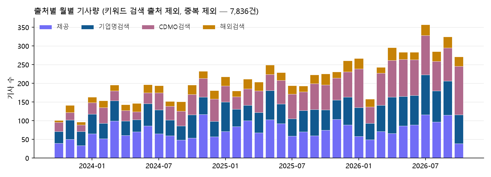
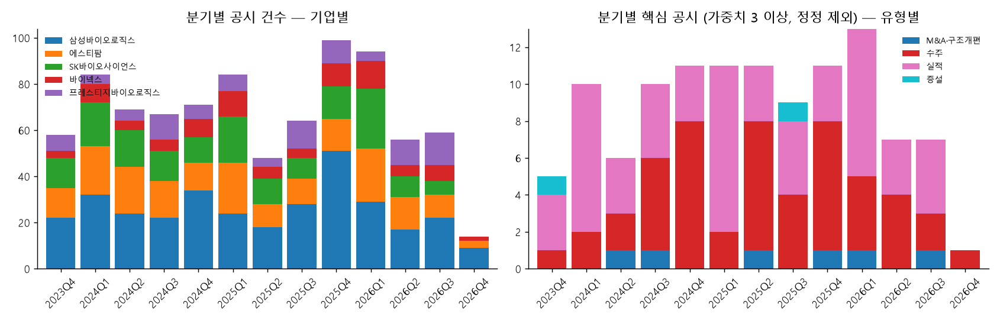
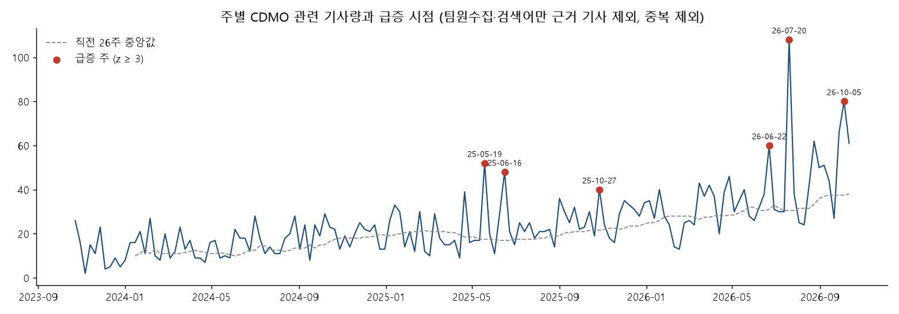

# 바이오 CDMO 뉴스·공시 이슈 대시보드 — 프로젝트 리포트

> **팀:** `kevin110419` · `dtt-dtdt`(한주) · `10010197`  
> **기간:** 2026-11-13 ~ 11-19 (데이터 기간 2023-10-19 ~ 2026-10-19)  
> **저장소:** `AI-Campus-1st/mid_proj_bio` · 실행: 저장소 루트에서 `streamlit run dashboard/app.py`  
> **작성:** 2026-11-19, 저장소의 문서·코드·결과 파일을 근거로 정리. 장마다 자세한 내용이 있는 문서를 함께 적었다.

---

## 요약

- **질문:** 글로벌 바이오 CDMO 산업에서 지금 어떤 변화가 일어나고 있고, 그것이 국내 CDMO 기업의 사업 기회와 경쟁력에 어떤 영향을 주는가.
- **데이터:** 뉴스 9,216건(제공 2,792 + 추가 수집 6,424)과 5개사 DART 공시 867건(원문 864건)을 SQLite 하나에 같은 스키마로 모았다.
- **AI 분석:** LLM(`gpt-6-luna`)으로 CDMO 기사 4,727건의 영향(기회·위험·중립), 이슈, 모달리티를 붙이고, 표본을 사람이 검수했다. 감성 정확도 85.0%(180건), 이슈 이름 98.7%(30건, 층 가중)이다.
- **공시 Q&A:** 공시 원문 36,548개 청크로 RAG를 만들었다. 평가 20문항에서 검색 정확도 12/14, 근거 없는 질문 거절 6/6이다.
- **결론:** 지금 CDMO 시장 현황은 **우호적**이다. 기회 기사가 위험 기사의 9배(2,186 대 234)이다.
  - 기회는 삼성바이오로직스의 폴리펩타이드 인수와 대형 수주, 에스티팜 올리고 수주, CDMO 특별법에 몰려 있다.
  - 위험은 미국 의약품 관세와 삼성바이오로직스 노사 갈등에 집중된다.

---

## 1. 분석 목적

### 1-1. 대상 산업: 바이오 → CDMO

- 과제가 제시한 6개 산업군 중 **바이오**를 골랐다. 임상·허가 같은 규제 이슈와 기술이전 공시가 뚜렷하게 연결되기 때문이다.
- 바이오 전체는 범위가 넓어 **CDMO(위탁개발생산)**로 좁혔다. 수주·증설 공시로 사업 활동이 바로 확인되는 업종이라, "뉴스의 변화가 실제 사업 활동인가"를 공시로 검증하기 좋다. ([PRODUCT_BRIEF](01_product-strategy/PRODUCT_BRIEF.md) 3-1절)

### 1-2. 대상 기업 5개사

- **후보:** CDMO 사업을 하는 국내 상장사 14곳. 비상장사(롯데바이오로직스, SK팜테코)는 DART 정기공시가 없어 뺐다.
- **자격 요건:** 기간 내 사업보고서 3건(G1), 불성실공시법인 지정 이력 없음(G2), 수주 공시 3건 이상(G3).
- **점수:** 공시 유형별 가중치를 곱해 더했다.
  - 가중치: 수주 5 · 증설 4 · M&A 4 · 실적 3 · 임상·허가·기술계약 2 · 자금조달 2 · 정기보고서 1 · IR·리스크·기타 0
  - IR은 처음 1점이었다. 그러자 에스티팜이 IR 46건만으로 점수의 3분의 1을 얻어 0점으로 고쳤다.

| 순위 | 기업 | 가중 점수 | 본업 점수(5×수주 + 4×증설) | 역할 |
|---|---|---|---|---|
| 1 | 삼성바이오로직스 | 198 | 110 | 비교 기준점 (2025 매출 4조 5,570억 원) |
| 2 | SK바이오사이언스 | 112 | 19 | 인수와 자체 백신 개발 병행 |
| 3 | 에스티팜 | 99 | 25 | 올리고핵산 CDMO, 다른 모달리티 |
| 4 | 프레스티지바이오로직스 | 98 | 75 | 가중 점수의 77%가 수주, CDMO 순도 최고 |
| 6 | 바이넥스 | 46 | 24 | 5위 팬젠 대신 포함 |

- **바이넥스를 넣은 이유:** 팬젠보다 본업 점수가 높고(24 대 20), 2025-09 증설 공시가 있으며, 매출이 약 12배다.
- **가중치의 성격:** 팀이 정한 판단 기준이다. 통계로 추정한 값이 아니다. ([company_selection](company_selection.md), [DART_DATA_SPEC](03_data/DART_DATA_SPEC.md) 1절)

### 1-3. 대시보드 사용자와 핵심 질문

- **사용자:** 바이오 CDMO 기업의 사업전략·기획 담당자.
  - 예시: 국내 중견 CDMO 사업전략팀 과장, 업계 경력 8년.
  - 하는 일: 경영진 보고자료를 쓴다. 뉴스·DART·산업 보고서를 따로 찾아본다.
- **Pain Point** ([PERSONA](01_product-strategy/PERSONA.md))
  - P1: 정보가 여러 채널에 흩어져 있다.
  - P2: 개별 뉴스가 산업·기업에 주는 영향을 판단하기 어렵다.
  - P3: 경쟁사 비교가 어렵다.
  - P4: 공시 근거를 찾는 데 시간이 걸린다.
- **핵심 질문:** "글로벌 바이오 CDMO 산업에서 지금 어떤 변화가 발생하고 있으며, 이러한 변화가 우리 기업의 사업 기회와 경쟁력에 어떤 영향을 미치는가?" 과제 공통 질문("지금 무슨 일이 일어나고 있으며, 그 근거는 무엇인가")을 CDMO 실무자 관점으로 바꾼 것이다.
- **영역별 질문:** 이 질문을 다섯 영역(산업 동향, 정책·규제, 기술·생산, 시장·경쟁, 근거·의사결정)으로 나눴고, 각 영역이 대시보드 화면 하나에 대응한다. ([dashboard_questions](dashboard_questions.md))
- **한계:** 실제 사용자 인터뷰는 하지 못했다. 니즈는 가설 단계다. ([USER_RESEARCH](01_product-strategy/USER_RESEARCH.md))

---

## 2. 데이터

### 2-1. 구성과 기간

**기간:** 2023-10-19 ~ 2026-10-19. 제공 뉴스의 기간에 공시와 추가 뉴스를 맞췄다.

| 출처 | 수집 방법 | 건수 | 본문 |
|---|---|---|---|
| 제공 | 과제 제공 (네이버 뉴스, 바이오 키워드 5개) | 2,792 | 있음 |
| 키워드 검색 (팀원 수집) | 팀원이 네이버 API로 CDMO 규제·투자유치 검색어를 모은 기사. 기사량 추이에서는 제외(3-1절) | 1,306 | 있음 |
| 기업명검색 | 구글 뉴스 RSS, 5개사 이름 | 2,202 | 제목만 |
| CDMO검색 | 구글 뉴스 RSS, CDMO 검색어 25개 | 2,119 | 제목만 |
| 해외검색 | 구글 뉴스 RSS 미국판, 영어 검색어 4개 | 797 | 제목만 |
| **뉴스 합계** | | **9,216** | 본문 있음 4,059 |
| **공시** | DART OpenAPI, 5개사 | **867** | 원문 864건 (파일 891개, 약 3,189만 자) |

- **뉴스:** 한국어 8,419건, 영어 797건이다. 영어 기사는 모두 LLM으로 번역한 한국어 제목이 있다.
- **공시 접수일:** 2023-10-23 ~ 2026-10-16.
- **기업별 공시:** 삼성바이오로직스 332, 에스티팜 189, SK바이오사이언스 167, 프레스티지바이오로직스 95, 바이넥스 84.
- **정정 공시:** 154건.
- **원문이 없는 3건:** 모두 첨부정정이다. DART가 오류 014를 돌려줬다.

### 2-2. 수집 과정

- **구글 뉴스 RSS** (`collect/collect_news*.py`)
  - 30일 구간씩 기간을 지정해 검색했다. 한 번에 최대 100건이라, 100건에 닿으면 구간을 반으로 나눠 다시 받았다.
  - 1초 간격으로 호출했다. 끊긴 곳부터 이어받을 수 있다.
- **DART OpenAPI** (`collect/collect_dart_*.py`)
  - `corpCode.xml`: 기업 코드
  - `list.json`: 공시 목록. 공시 유형 A~J별로 호출했다.
  - `document.xml`: 원문 zip
  - `fnlttSinglAcnt.json`: 2025 매출
- **통합과 적재**
  - `analysis/build_cdmo_news.py`가 출처를 합치고 CDMO 키워드를 다시 분류한다.
  - `db/build_db.py`가 SQLite(`data/db/bio_cdmo.sqlite`)에 적재한다. 적재 단계는 API를 부르지 않아 같은 결과를 다시 만들 수 있다.
- **출처 간 겹침**
  - 링크가 같거나 정규화 제목이 같으면 같은 기사로 본다.
  - 본문이 있는 쪽을 남긴다: 제공 > 키워드 검색 > 기업명검색 > CDMO검색 > 해외검색. ([NEWS_DATA_SPEC](03_data/NEWS_DATA_SPEC.md), [news_sort](news_sort.md))
- **DB 안의 중복**
  - 정규화 제목이 같고 발행일이 7일 이내면 중복으로 본다. 74건이다.
  - 지우지 않고 `dup_of`로 표시만 한다.
- **정제** (`analysis/clean_text.py`, 정규표현식)
  - 기자 서명·저작권 문구·이메일·URL을 지웠다.
  - 본문은 0.9% 줄었다.

### 2-3. 통합 스키마

| 테이블 | 행 수 | 내용 |
|---|---|---|
| `companies` | 5 | 5개사 (corp_code, 이름, 선정 점수) |
| `news` / `news_clean` | 9,216 / 9,216 | 기사 원본(출처·언어·중복 표시·번역 제목)과 정제 본문 |
| `news_cdmo_keywords` | 7,343 | 기사 × CDMO 키워드 6종 (규제·정책, 지정학, 모달리티, 생산능력, 수주, 경쟁 구도) |
| `news_companies` | 3,606 | 기사 × 기업 (제목·본문·검색어 중 어디서 찾았는지) |
| `disclosures` / `disclosure_documents` | 867 / 891 | 공시 목록(`event_class`·가중치·정정 여부·DART 링크)과 원문 |
| `v_documents` (뷰) | 10,259행 | 뉴스와 공시를 같은 14개 열로 합친 뷰. 뉴스가 기업별로 한 행씩이라 문서 수(10,083)보다 많다 |

자세한 정의는 [DATABASE_SCHEMA](06_technical/DATABASE_SCHEMA.md)와 `db/schema.sql`에 있다.

---

## 3. EDA

전체 내용은 [eda_report](eda_report.md)에 있다. 그림은 `analysis/eda.py`가 만든다.

### 3-1. 기사량 추이

기사량은 대시보드 이슈·트렌드 화면과 같은 기준으로 센다: 중복을 빼고, "키워드 검색" 출처(1,306건, 2-1절)를 뺀 **7,836건**이다.

| 연도 | 기사 수 | 월평균 |
|---|---|---|
| 2023 (10-19부터) | 339 | — |
| 2024 | 2,107 | 176 |
| 2025 | 2,620 | 218 |
| 2026 (10-19까지) | 2,770 | 약 280 |



- **추이:** 월평균 기사량이 2024년 176건 → 2025년 218건 → 2026년 약 280건으로 꾸준히 늘었다. 2026년 기사는 2025년보다 6% 많다.
- **키워드 검색 출처를 뺀 이유:** 이 출처는 팀원이 네이버 API로 따로 모은 기사인데, 기간을 지정하지 못하고 최신순으로 받아 1,162건(89%)이 2026년에 몰려 있다. 넣으면 2026년이 46% 늘어난 것처럼 보여, 수집 방식 때문에 생긴 증가를 시장 관심 증가로 잘못 읽게 된다. 그래서 기사량 추이와 급증 분석에서는 늘 뺐다. 기사 목록·감성 분류·요약 카드 근거에는 쓴다.
- **CDMO 관련 기사:** 4,151건(45%)이다. 제공 뉴스는 바이오 전반 기사라 88%가 CDMO와 무관했다.

### 3-2. 공시 추이



- **분기별 공시:** 2025Q2에 48건으로 가장 적었고, 2025Q4에 99건으로 가장 많았다.
  - 2025Q4의 99건 중 51건이 삼성바이오로직스다. 인적분할 뒤 지분 변동 신고가 몰렸다.
  - 사업보고서가 나오는 2~3월에 공시가 많다.
- **유형별 공시:** 기타(지분·주총·행정)가 469건(54%)으로 가장 많다. 그다음은 수주 98건(정정 49건 포함), IR 75, 정기보고서 68, 실적 57, 임상·허가·기술계약 54, M&A 15, 자금조달 12, 리스크 11, 증설 5건이다.

### 3-3. 이슈 급증 시점과 배경

**판정 방법**
- 주(월요일 시작) 단위로 본다.
- 직전 26주 중앙값과 비교해 z = (그 주 건수 − 중앙값) / (MAD × 1.4826)를 구하고, z ≥ 3이면 급증이다.
- 최소 건수도 넘어야 한다: 산업 전체 20건, 키워드 8건, 기업 6건.
- 급증 주가 이어지면 한 사건으로 묶는다.
- 결과는 67건이다(산업 전체 6, 키워드 27, 기업 34).



| 급증 주 | 주간 기사 (평소) | z | 배경 | 근거 |
|---|---|---|---|---|
| 2026-07-20 | 108 (30.5) | 8.0 | 삼성바이오로직스, 폴리펩타이드 2.7조 원 인수 발표 | 제목 빈출어 "인수" 34회 · "폴리펩타이드" 27회 |
| 2025-05-19 | 52 (17.5) | 5.2 | 삼성바이오로직스 인적분할 발표 | 05-22 회사분할결정 공시 |
| 2025-06-16 | 48 (17.0) | 4.2 | 바이오 USA 2025 | 제목 빈출어 "USA"·계약·수주 |
| 2026-10-05 | 80 (37.5) | 3.6 | CPHI 밀라노 참가와 수주 홍보 | 제목 빈출어 "수주" 19회 · "CPHI" 15회 |
| 2026-06-22 | 60 (31.0) | 3.3 | 바이오 USA 2026 | 제목 빈출어 "USA" 21회 |
| 2025-10-27 | 40 (21.5) | 3.1 | CPHI 2025와 3분기 실적 시즌 | 약한 급증 |

**해석**
- **산업 전체:** 급증 6건 중 2건은 한 기업의 구조 변화(인수, 분할)이고, 4건은 바이오 USA(6월)·CPHI(10월) 같은 정기 행사다. 행사 주간 급증은 화면에 "정기 행사"로 따로 표시했다.
- **키워드별 급증의 예**
  - 지정학 2024-09: 미국 생물보안법 하원 통과
  - 규제·정책 2025-01: 국가바이오위원회 출범
  - 지정학 2026-04: 미국 의약품 관세
- **기업별 급증 34건과 공시의 관계**
  - 71%(24건)는 같은 시기(급증 1주 전 ~ 2주 뒤)에 그 기업의 공시가 있었다. 기사와 공시가 같은 사건으로 확인된 경우는 11건이다(예: 바이넥스 오송공장 증설, 에스티팜 913억 원 수주).
  - 공시 없이 기사만 급증한 10건은 대부분 행사·인사·홍보성 보도였다.
  - 폴리펩타이드 인수는 기사 급증 6주 뒤(2026-08-31)에야 취득결정 공시가 나왔다. 뉴스가 공시보다 앞서는 사례다.

---

## 4. AI 기반 이슈 분석

자세한 내용은 [AI_CLASSIFICATION](04_ai/AI_CLASSIFICATION.md), [AI_EVALUATION](04_ai/AI_EVALUATION.md), [LLM_RETROSPECTIVE](04_ai/LLM_RETROSPECTIVE.md)에 있다.

### 4-1. 공통 설계

- **모델: `gpt-6-luna`**
  - 같은 표본으로 큰 모델 `gpt-6.1-sol`과 비교했다. 정확도는 84.4% 대 85.6%로 1.2%p 차이였고, 단가는 20분의 1이었다.
- **미리 처리해 저장**
  - 분류 결과는 모두 미리 만들어 CSV로 저장한다. 대시보드는 저장된 결과만 읽는다. 실시간으로 LLM을 부르는 것은 공시 Q&A뿐이다.
  - 결과마다 모델·프롬프트 버전·시각을 남겨, 어떤 설정에서 나온 결과인지 추적할 수 있다.
- **구조화 출력**
  - JSON 스키마로 출력 형식을 고정했다(라벨은 열거형, 판단 이유, 확신도).
  - 코드가 한 번 더 검증하고, 실패하면 사유를 기록한다.
- **실행 순서:** `--dry-run`으로 비용 확인 → 20~50건 시험 → 전체 실행. 이미 성공한 건은 건너뛴다.
- **입력:** 제목 + 본문 앞 1,500자. 본문이 없는 기사(약 74%)는 제목만 넣고, 그 사실을 결과에 표시한다(`input_basis`).

### 4-2. 작업별 프롬프트와 결과

| 작업 | 프롬프트 버전 | 출력 | 결과 (대상) |
|---|---|---|---|
| 감성(영향) 분류 | `sentiment-v3` | 기회 / 위험 / 중립 + 이유 + 확신도 | 4,727건: 기회 2,186 (46.2%) · 위험 234 (5.0%) · 중립 2,307 (48.8%), 실패 0 |
| 이슈 추출 + 묶기 | `issue-v1`, `issue-group-v1` | 이슈 이름, 유형 8종, 키워드 | 이름 3,581개 → 대표 이름 2,706개. 대표 이슈: 폴리펩타이드 인수 125건, 유상증자 122건, 미국 생물보안법 115건 |
| 모달리티 태깅 | `modality-v2` | 7종 (항체·ADC·mRNA·세포·유전자치료제·올리고·펩타이드·백신) + 기타, 근거 문장 | 태그 1,538건 (32.5%): 세포·유전자 394 · 펩타이드 379 · ADC 366 · 항체 244 |
| 영어 제목 번역 | `translate-v3` | 한국어 제목 | 797건, 실패 0 |

**감성 분류 기준을 세 번 고쳤다.**
- **v1:** "국내 CDMO 기업에 유리한가?" 개별 기업 관점이라, 평가자마다 해석이 갈렸다.
- **v2:** "CDMO 시장 전체의 파이가 커지는가?"로 바꿨다. 규칙도 6개에서 10개로 늘렸다.
- **v3:** "CDMO와의 관련성이 약하면 중립" 규칙을 더했다. v2보다 기회가 408건 줄고 중립이 412건 늘었다.

**이슈 묶기를 따로 둔 이유:** 같은 사건이 "삼성바이오 폴리펩타이드 인수", "폴리펩타이드 인수 추진"처럼 다른 이름으로 나뉘었다. 그래서 이름만 보고 같은 사건끼리 묶는 단계를 추가했다.

**뉴스-공시 매칭은 LLM이 아니라 규칙 기반이다.** 같은 기업, 날짜 창, 키워드와 공시 유형의 대응으로 7,135쌍을 연결했다. LLM은 검수 표본의 1차 판정에만 썼다.

### 4-3. 표본 검수 결과

| 대상 | 표본 | 결과 | 판정 |
|---|---|---|---|
| 감성 분류 (v3) | 180건, 층 18개 (입력 유형 3 × 키워드 6) | **정확도 85.0%** (153/180), 층 가중 84.2%. 모두 "기회"로 찍으면 47.2%. 라벨별 F1: 기회 0.854 · 위험 0.870 · 중립 0.843 | 3인 독립 라벨 → 합의 |
| 이슈 추출 | 30건 | 층 가중 정확 비율: 이름 98.7% · 유형 97.4% · 묶기 98.7% | 한주 |
| 모달리티 | 80건 | 정밀도 91.7% · 재현율 98.1% | Claude 블라인드 1차 → 한주 확인 |
| 번역 | 30건 | 의미·숫자·이름 30/30 (오류율 상한 약 10%) | 한주 |
| 뉴스-공시 매칭 | 50쌍 | 같은 사건 비율: 직접·당일 10/15 · ±1~3일 2/15 · 후속 0/20 | Claude 1차 → 경계 19쌍은 사람 2명 |

- **감성 분류, 입력별 정확도:** 본문 83.0%, 한국어 제목 83.5%, 영어 제목 90.5%. 제목만 있어도 정확도가 크게 떨어지지 않았다.
- **감성 분류, 확신도별 정확도:** high 90.8%, medium 71.1%. 그래서 화면에서 확신도 낮은 라벨에 배지를 붙였다.
- **평가자 간 일치도 (v1 기준, 합의 전)**
  - Cohen's kappa: A·B 0.484, A·C 0.299, B·C 0.335
  - Fleiss' kappa: 0.337 (낮은 일치)
  - 사람끼리도 판단이 갈렸다. 이것이 기준을 v2·v3로 고친 직접적인 이유다.

### 4-4. 한계

- **정답 수정:** v3 정답 180건 중 22건은 이전 버전 LLM 결과를 본 뒤 고쳤다. 정확도가 실제보다 조금 높게 나왔을 수 있다.
- **같은 설정의 편차:** 같은 설정으로 다시 돌리면 180건 중 11건의 라벨이 바뀐다(85.6% 대 85.0%).
- **입력과 표본:** 기사의 74%가 제목만 있다. 층별 표본은 5~20건이라, 층별 수치는 신뢰구간이 넓다.
- **정답의 출처:** 정답은 조원의 판단이며 업계 실무자의 판단이 아니다. 이슈·번역 검수는 판정자가 1명이고, 모달리티 1차 판정은 같은 계열 모델(Claude)이 했다.

---

## 5. 공시 Q&A (RAG)

### 5-1. 구성

```
질문 → ① 범위 확인 → ② 검색 → ③ 답변 생성 → ④ 인용 검증 → 화면
        (5개사 밖이면 거절)  (Chroma)   (gpt-6-luna, JSON)  (코드)
```

| 단계 | 설정 |
|---|---|
| 색인 | 공시 864건 본문. LangChain `RecursiveCharacterTextSplitter`로 1,000자 / 겹침 150자, 청크 앞에 `[기업명 \| 보고서명 \| 접수일]` 머리말 → **36,548개 청크** |
| 임베딩 · 벡터 DB | OpenAI `text-embedding-3-small` (약 2,919만 토큰, 약 $0.58), ChromaDB 코사인 거리 |
| 검색 | 사건성 공시(수주·증설·M&A·자금조달·실적·임상·허가·기술계약·리스크)에서 5개 + 전체에서 2개, 최대 7개. 같은 공시는 2개까지. 같은 보고서명이면 최신 정정 공시를 앞에 둔다 |
| 답변 | `gpt-6-luna`, JSON 출력: 답, 인용(공시 번호 + 원문 그대로의 80자 이내 구절), 거절 여부와 사유, 판단 요구 여부, 인과 미확인 여부. 규칙: 추측 금지, 문장마다 근거 공시 번호, 투자 판단 거절, 정정 공시 우선 |
| 검증 | 코드가 확인한다: 검색되지 않은 공시를 인용했거나 인용 구절이 원문에 없으면 거절로 바꾼다. 공시명·접수일·링크는 LLM이 아니라 색인 메타데이터에서 채운다 |

- **LangChain 사용 범위:** 청크 분할과 네 단계 연결(`RunnableLambda` 체인)에 썼다. 검색과 모델 호출은 ChromaDB와 OpenAI SDK를 직접 부른다(`rag/qa.py`).
- **사건성 공시 검색을 따로 둔 이유:** 정기보고서 하나가 청크를 최대 1,165개 차지해, 짧은 수시 공시(수주·증설)가 검색에서 밀려났다. 그래서 사건성 공시만 따로 검색해 자리를 보장했다.

### 5-2. 평가 (질문 20개: 답이 있는 질문 14, 거절해야 하는 질문 6)

| 지표 | 1차 | 개선 후 |
|---|---|---|
| 검색 정확도 (넘긴 청크 안에 정답 공시) | 8/14 | **12/14 (85.7%)** |
| 거절 정확도 (거절해야 할 질문을 거절) | 6/6 | **6/6** |
| 잘못된 거절 (답이 있는데 거절) | 4/14 | 1/14 |
| 근거 일치 (답한 질문 중 정답 공시 인용) | 7/10 | 12/13 (92.3%) |
| 핵심 값 일치 (금액·날짜 등) | 6/10 | 10/13 (76.9%) |

**질의응답 예시** (대시보드 예시 질문 3개와 같다)

| 질문 | 답 (요지) | 근거 공시 |
|---|---|---|
| 삼성바이오로직스가 2026년 10월에 자율공시한 의약품 위탁생산계약의 계약금액과 계약기간 종료일은? | 93,478,620,919원, 2031년 12월 31일 | 20261002800830 (비슷한 수주 공시 53건 중 정답을 1순위로 찾음) |
| 바이넥스의 오송공장 신규시설투자 금액과 투자기간은? | 557억 3천만 원, 2025-09-22 ~ 2026-11-30 | 20250922900023 |
| SK바이오사이언스의 RSV 예방항체 기술도입 계약의 상대방과 총 계약금액은? | Gates Medical Research Institute(미국), 1,625만 달러(약 237억 원) | 20260203800659 |

### 5-3. 근거 표시 방식 (공시 Q&A 화면)

- **답변:** 본문에 "AI 생성" 배지를 붙인다.
  - 인과관계를 묻는 질문에는 "인과는 공시로 확인되지 않음"을 표시한다.
  - 투자 판단을 묻는 질문에는 판단하지 않고 공시 사실만 안내한다.
- **근거 공시 목록:** 보고서명(링크) · 정정 배지 · 접수일 · 기업 · DART 원문 링크를 보여 주고, 펼치면 인용 구절이 원문 그대로 나온다.
- **근거가 없을 때**
  - 오류처럼 보이지 않게 "공시 근거 없음" 한 줄로 알린다.
  - 질문 단어가 제목에 든 관련 뉴스 최대 5건을 "공시로 확인된 답은 아님" 안내와 함께 보여 준다. 이 단계는 LLM을 부르지 않는다.
- **질문 범위:** 사이드바 필터의 기간·기업을 따를지 체크박스로 고른다. 요약 화면 검색창, 예시 질문, 공시 표 행에서 바로 질문할 수 있다.

### 5-4. 한계

- **평가의 한계:** 질문이 20개뿐이고, 시스템을 만든 사람이 직접 썼다. 사건성 공시 자리 수(5개)도 평가 질문을 보고 정했다.
- **검색의 한계:** 질문 속 날짜·분기를 검색 조건으로 쓰지 못한다. 그래서 "2분기 실적" 질문을 반기 누계만 있다며 거절한 사례가 있다.
- **환각의 형태:** "없는 말 지어내기"보다 "맞는 문서의 틀린 대상"으로 나타났다(예: 같은 날의 원공시와 정정 공시 혼동).

---

## 6. 대시보드

### 6-1. 화면 구성과 스토리라인

7개 화면이 각각 핵심 질문 하나에 답한다. 사이드바 공통 필터(기간, 5개사, CDMO 키워드 6종)는 화면을 옮겨도 유지된다.

| 메뉴 | 화면 | 답하는 질문 | 주요 구성 |
|---|---|---|---|
| — | **요약** | 지금 주목할 기회와 위험은? | 결론 띠, 지표 4개(최근 3개월 증감), 월별 기회 vs 위험, 기회·위험 요인 카드, 공시에 물어보기, 최근 주요 공시 |
| 산업 흐름 | 이슈·트렌드 | 가장 많이 다뤄지는 이슈, 새로 떠오르는 이슈는? | 기사량 추이(출처별·키워드별), 급증 시점과 대표 기사·같은 시기 공시, 부상 이슈 |
| | 규제·정책 | 정책·규제 변화는 기회인가 위험인가? | 기회/위험/중립 지표, 월별 감성 추이, 판단 이유가 붙은 기사 타임라인, 언급 기업(5개사) |
| | 기술·생산 | 어떤 모달리티·생산기술이 성장하는가? | 모달리티 추이, 기업 × 모달리티 히트맵, 증설 공시 |
| 경쟁 | 기업 비교 | 경쟁사의 수주·증설·투자는 어떻게 변하는가? | 분류별 공시 건수, 기업별 공시 타임라인, 수주 계약 금액 추이 |
| 근거 확인 | 뉴스-공시 연계 | 뉴스의 변화가 공시로 확인되는가? | 연결 지표(연결 없는 기사 비율), 기사량과 공시 시점, 이슈별 관련 공시 |
| | 공시 Q&A | 공시 원문에 근거한 답은? | 질문 → 답변 + 근거 공시 + 인용 구절 |

**스토리라인:** 대표 시나리오는 "미국 공급망 정책이 국내 CDMO에 주는 기회"이다([USER_FLOW](05_design/USER_FLOW.md)).

1. 요약에서 결론을 본다.
2. 규제·정책에서 정책 흐름이 기회인지 위험인지 확인한다.
3. 이슈·트렌드에서 기사가 급증한 시점을 찾는다.
4. 기업 비교에서 경쟁사의 수주·증설을 비교한다.
5. 뉴스-공시 연계와 공시 Q&A에서 공시 원문으로 확인한다.
6. 다시 요약에서 보고할 결론을 정리한다.

요약 카드의 "자세히 →"는 카드의 기간·기업·키워드를 필터로 넣고 해당 화면으로 이동한다. 모든 화면 아래에는 "데이터 범위·한계"를 둔다.

### 6-2. 도출한 결론 (요약 화면 상단)

> ## 지금 CDMO 시장 현황은 우호적
> **기회** 삼성바이오로직스의 폴리펩타이드 인수와 대형 수주 · 에스티팜 올리고 수주 · CDMO 특별법  
> **위험** 미국 의약품 관세와 삼성바이오로직스 노사 갈등
>
> 기회 기사가 위험 기사의 9배 · 기회 2,186건 · 위험 234건 · CDMO 뉴스 4,727건 · 2023년 10월 ~ 2026년 10월

- **판단 규칙:** 한쪽 기사가 다른 쪽의 2배 이상이면 그쪽으로 판단한다: 우호적 / 비우호적 / 중립.
- **표현:** 사업전략팀이 내부 보고에 쓸 수 있도록 "기회 우위" 대신 "우호적" 같은 업황 판단 용어를 썼다.
- **결론 문장과 카드의 근거**
  - 결론 문장과 카드 문구는 데이터로 쓴 AI 초안을 팀이 확인했다.
  - 근거 기사·공시·건수는 스크립트(`analysis/build_summary_cards.py`)가 데이터에서 뽑아 다시 만들 수 있다.

| 기회 요인 | 기사 | 위험 요인 | 기사 |
|---|---|---|---|
| 삼성바이오, 2.7조 폴리펩타이드 인수로 펩타이드(비만약) CDMO 진출 | 234 | 미국 의약품 관세 발효 | 37 |
| 삼성바이오로직스, 대형 수주 지속 — 누적 수주 220억 달러 돌파 | 64 | 삼성바이오로직스 노사 갈등이 3조 유상증자·신공장 일정에 부담 | 66 |
| 에스티팜, 올리고 수주 확대 — 913억 원 역대 최대 계약 | 65 | 품질·규제 처분 — 바이넥스 제조정지, 노보 노디스크 FDA 제재 | 8 |
| CDMO 특별법 하위법령 입법 예고, 2026년 12월 시행 | 66 | | |
| 생산능력 증설 — 삼성 5·6공장, 바이넥스 오송, 롯데 송도 | 86 | | |

미국 생물보안법은 기사 수가 많은 대표 이슈(115건)였지만 108건이 "중립"으로 분류돼, 기회·위험 어느 쪽 카드에도 넣지 않았다([DECISIONS](07_project-management/DECISIONS.md) D-30).

### 6-3. 검증과 디자인

- **필터 반영 점검** (`tests/check_dashboard_filters.py`, Streamlit AppTest, API 호출 없음)
  - 필터 조합 17개(기본 + 기간·기업·카테고리 변형 16개)로 7개 화면을 실행했다. 화면 실행 119회, 오류 0건이다.
  - "변화 없음" 7건은 공시 Q&A의 카테고리 조합이다. 공시 Q&A는 카테고리로 범위를 정하지 않도록 설계했다.
- **화면 확인:** 브라우저로 1366×768에서 결론이 스크롤 없이 보이는지, 다크 모드, 번역 제목 표시, Q&A 근거 표시를 확인했다([TEST_PLAN](07_project-management/TEST_PLAN.md)).
- **디자인**
  - `DESIGN.md`(스타벅스 디자인 시스템)를 바탕으로 했다: 크림 캔버스, 초록 계열, 알약 버튼, 12px 카드.
  - 결론 띠는 진녹색 면에 흰 글자로 강조했다.
  - 차트 데이터 색은 색각 대비를 검증한 값을 그대로 썼다.
- **뺀 것:** 규제·정책 화면에 계획했던 "해외 CDMO 언급 수" 차트는 해외 CDMO를 셀 기준(대상 기업 목록·영문 표기)을 정하지 못해 "준비 중"으로만 남아 있었다. 근거 없는 수치를 보여 주지 않으려고 화면에서 뺐다([DECISIONS](07_project-management/DECISIONS.md) D-38). 이제 "준비 중"으로 남은 요소는 없다.

---

## 7. 회고

### 7-1. LLM 활용 시 발생한 문제와 대응

| # | 문제 | 대응 |
|---|---|---|
| 1 | 라벨 기준을 사람마다 다르게 해석해 정답이 흔들렸다 (감성 Fleiss' kappa 0.337, 매칭 kappa 0.15) | 기준을 한 문장으로 다시 정의했다(감성 v2 "시장 전체의 파이", v3 "관련성 약하면 중립"). 매칭은 합의 규칙을 문서로 만들었다 |
| 2 | 규칙을 더하면 오류가 다른 쪽으로 옮겨 갔다 (중립→기회 오류 22건이 12건으로 줄고, 기회→중립 오류는 5건이 12건으로 늘었다) | 전체 정확도(84.4% → 85.0%)만 보지 않고 오분류가 어느 방향으로 옮겨 갔는지 기록했다. "규칙은 오류를 없애기보다 옮긴다"를 한계로 남겼다 |
| 3 | 같은 설정으로 돌려도 180건 중 11건이 바뀌었다 | 결과 파일에 모델·버전·시각을 남기고, 한 번 만든 결과를 고정해 썼다. 편차를 한계로 명시했다 |
| 4 | 검증 규칙이 한국어 기준이라 맞는 답이 실패로 처리됐다 (영어 키워드, 영어 근거 문장, 이름뿐인 제목) | 실패 사유를 기록해 원인을 찾고, 규칙을 고쳐 다시 돌렸다(예: 근거 길이 20자 → 30자) |
| 5 | 모달리티를 배경 설명만 보고 태그했다 | 실제 실패 문장을 프롬프트 예시로 넣었다(v2) |
| 6 | 번역 예시가 답을 끌고 갔다 (옛 회사 이름, 표기 혼재, 없는 "달러" 덧붙임) | 표기 목록 35개로 고정하고, 원제목에 없는 단위를 붙이지 말라는 규칙을 넣었다(v3) |
| 7 | 같은 사건이 다른 이슈 이름으로 나뉘었다 | 이름 묶기 단계를 추가했다 |
| 8 | RAG: 긴 정기보고서가 짧은 수시 공시를 검색에서 밀어냈다. 환각은 "맞는 문서의 틀린 대상"으로 나타났다 | 사건성 공시 검색 자리를 따로 두었다. 인용 구절을 코드로 원문과 대조하고, 공시 메타데이터는 LLM이 아니라 색인에서 채웠다 |
| 9 | 검수자가 LLM 답을 보면 그쪽으로 끌려갔다 | 검수자는 LLM 결과를 보지 않고 먼저 판정했다(블라인드). 표본은 시드를 고정해 다시 뽑을 수 있게 했다 |

**배운 점**
- LLM 결과의 품질은 프롬프트보다 **기준의 정의**에 더 크게 좌우됐다. 사람끼리 합의하지 못한 기준은 LLM도 일관되게 지키지 못했다.
- "정확도 85%"는 표본·정답·버전 조건이 붙어야 의미가 있다. 그래서 결과마다 그 조건을 기록하고, 화면 한계 문구에도 적었다.
- 비용이 드는 작업(LLM·임베딩)은 dry-run으로 비용을 먼저 확인하고 승인한 뒤 실행했다.

### 7-2. 역할 분담

가이드가 경계한 "한 사람이 모든 계층, 다른 사람은 문서만"을 피하려고, 수집·분석·RAG·화면 계층을 각자 하나 이상 맡았다. 나누는 단위는 계층이 아니라 **산출물·화면**이었고, 세 사람 모두 두 개 이상의 계층에 코드를 남겼다([TASKS](07_project-management/TASKS.md) 1절, [LLM_RETROSPECTIVE](04_ai/LLM_RETROSPECTIVE.md) 5-1절).

| 담당 | 맡은 영역 |
|---|---|
| `kevin110419` | 저장소·DART 수집·DB 초기 구성, 기업 선정, CDMO 뉴스 추가 수집·재분류, `CLAUDE.md` 협업 규칙, 정제·EDA, 감성 분류 기준 확정·LLM 전체 실행·표본 정답, 대시보드 설계(정보 구조·와이어프레임·UI 명세), 사이드바·필터 UI |
| `dtt-dtdt` (한주) | 팀원 뉴스 수집, 급증 분석, 뉴스-공시 매칭 설계·스크립트, 이슈 추출·묶기, 모달리티 태깅·검수, 영어 제목 번역·검수, 수주 계약 금액, 대시보드 기술·생산·기업 비교·부상 이슈, LLM 회고 초안 |
| `10010197` | 프로젝트 설정·해외 뉴스 보강·문서 구조, 감성 라벨링 도구·검수 합본, 공시 RAG(색인·질의응답·평가), 매칭 표본 판정, 대시보드 뼈대·요약·이슈·트렌드·규제·정책·뉴스-공시 연계·공시 Q&A·통합 점검, 리디자인 |
| 공동 | 통합 스키마(Day 1), 감성 표본 3인 검수, 매칭 표본 사람 판정, 설계 결정 합의 |

### 7-3. 협업 방식

- **브랜치:** 처음에는 Gitflow(develop + feature + PR)로 시작했다.
  - 11-13에 `main` 단일 브랜치로 바꿨다.
  - 11-17에는 PR 절차도 없앴다. 같은 공간에서 실시간으로 협의해 PR 대기가 병목이었기 때문이다.
  - 지금은 `feature/<이름>` 브랜치에서 작업해 `main`에 직접 병합한다([DECISIONS](07_project-management/DECISIONS.md) D-34~D-36).
세 명이 각자 AI 코딩 도구(Claude Code)로 동시에 작업했다. AI는 여러 파일을 빠르게 고치므로 서로 덮어쓰기 쉬워, 아래 규칙을 `CLAUDE.md`에 두고 지켰다([LLM_RETROSPECTIVE](04_ai/LLM_RETROSPECTIVE.md) 5-2절).

| 규칙 | 이유 | 실제로 생긴 일 |
|---|---|---|
| 고치기 전에 다른 팀원의 변경 확인: 원격 받기, 같은 파일의 다른 브랜치 변경, 팀원 기록 파일. 겹치면 멈추고 묻는다 | 덮어쓰기 방지 | `dashboard/core/data.py`에 규제·정책 구간과 기술·생산·기업 비교 구간이 동시에 추가됐다. 확인한 뒤 두 구간을 모두 살려 합쳤다 |
| 세션마다 기록 파일(`<닉네임>.md`)에 브랜치·기준 커밋·원본 대비 변경을 남긴다 | 누가 왜 무엇을 바꿨는지 따라갈 수 있게 | 결정 기록([DECISIONS](07_project-management/DECISIONS.md))을 이 기록에서 모아 만들었다. 기록 수(11-19 기준): `kevin110419` 26건, 한주 42건, `10010197` 97건 |
| PR 대기 없이 작업 브랜치 → `main` 직접 병합 (D-35) | 같은 공간에서 바로 협의해 PR 리뷰 대기가 병목이었다 | 처음 Gitflow(develop + PR)에서 11-13 `main` 단일 브랜치, 11-17 PR 생략으로 바꿨다. 병합 직전에 `main`을 받아 충돌을 줄였다 |
| LLM 결과는 CSV로 저장, API 키는 `.env` | 재실행 비용 절약, 키 노출 방지 | 키는 저장소에 올라가지 않았다 |

**함께 판단한 방식**
- **정답은 여러 사람이 만든다:** 감성 표본 180건은 3명이 따로 판정해 일치도를 쟀다. 매칭 표본은 두 사람이 서로의 판정을 보지 않고 판정했다.
- **기준을 먼저 합의한다:** 매칭 판정의 일치도가 kappa 0.15로 낮아, "같은 사건"의 정의를 합의한 뒤 다시 판정했다(D-27).
- **결정은 이유와 함께 남긴다:** 주요 결정 38건마다 이유·대안·결과를 [DECISIONS](07_project-management/DECISIONS.md)에 적었다. 발표 때 누구든 설명할 수 있게 하기 위해서다.

### 7-4. 잘 안 된 점과 배운 점

([LLM_RETROSPECTIVE](04_ai/LLM_RETROSPECTIVE.md) 5-4절, 한주 초안 — 팀 검토 중)

| 문제 | 현상 | 대응과 배운 점 |
|---|---|---|
| 수집 기사가 대기업 쪽으로 치우쳤다 | 5개사가 언급된 기사 2,725건 중 삼성바이오로직스가 1,763건(65%), 프레스티지바이오로직스는 69건이다. 요약 카드 8개 중 4개가 삼성바이오로직스 이야기이고, 중소형사의 변화는 급증·부상 이슈에 잘 잡히지 않는다 | 기업 필터로 따로 볼 수 있게 했고, 기업 비교는 기사 수가 아니라 공시 기준으로 했다. 전체 결론에는 보정을 하지 않아 편향이 남았다. 수집 단계에서 기업별 목표 건수를 정하거나, 기업별 비율 지표를 함께 보여 줬어야 했다 |
| "키워드 검색" 기사가 2026년에 쏠렸다 | 네이버 API로 모은 1,306건 중 1,162건(89%)이 2026년이다. API에서 기간을 지정하지 못하고 검색어마다 최신순으로 받았기 때문이다 | 기사량 추이·급증·부상 이슈 계산에서 뺐다(3-1절). 수집 전에 API의 기간 지정 기능을 확인하고, 수집 직후 출처별 시기 분포를 점검했어야 했다. 이번에는 EDA 단계에서야 발견했다 |
| 문서가 실제 작업보다 늦었다 | 작업이 끝났는데도 문서에 "검수 전", "준비 중"으로 남은 곳이 있었다 | "자기 기록·문서만 고친다"는 규칙 때문에 다른 사람 문서의 상태가 늦게 따라왔다. 11-19에 문서 전체를 코드와 대조해 한꺼번에 맞췄다. 작업이 끝나면 문서 담당자에게 바로 알리는 단계가 필요했다 |
| 팀원이 없을 때 결정이 미뤄졌다 | UI 명세의 확인 항목(U1~U5)을 "제안"대로 먼저 구현하고 "팀 확인 전"으로 표시했다(D-31) | 표시해 두는 방식은 작업을 막지 않았지만, 확인 자체는 끝까지 남았다 |

---

## 부록. 재현 방법

```bash
pip install -r requirements.txt          # .env 에 DART_OPEN_API, OPENAI_API_KEY (.env.example 참고)
python db/build_db.py                     # 원본 → SQLite (API 호출 없음)
python analysis/eda.py                    # EDA 표·그림
python analysis/label_sentiment.py --all --dry-run   # LLM 비용 확인 → --all 로 실행
python rag/build_index.py                 # 공시 색인 (임베딩 비용 약 $0.58)
streamlit run dashboard/app.py            # 대시보드
python tests/check_dashboard_filters.py   # 필터 반영 점검
```
