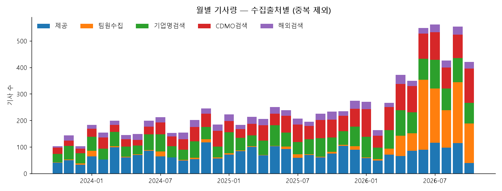
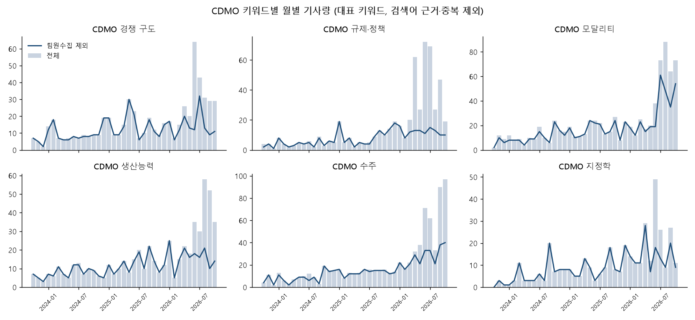
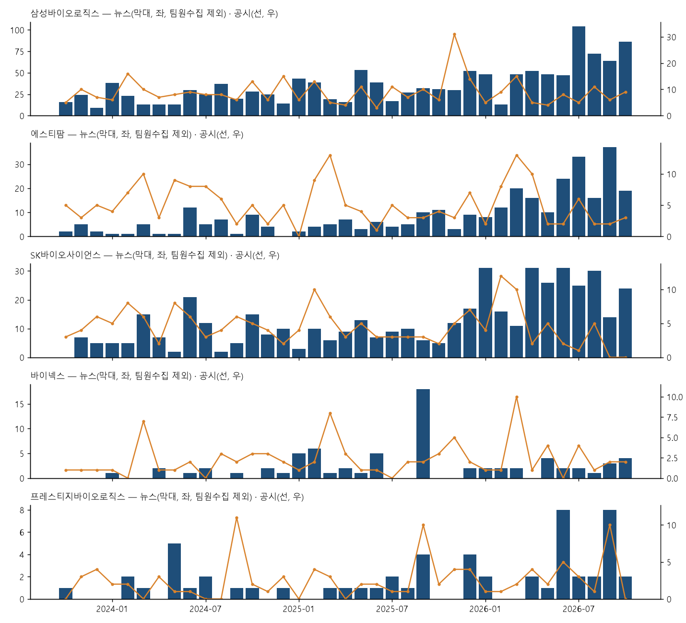
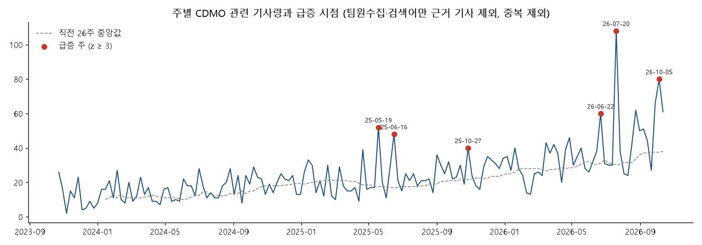
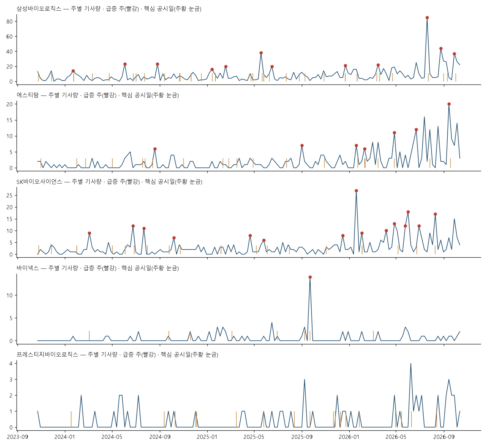
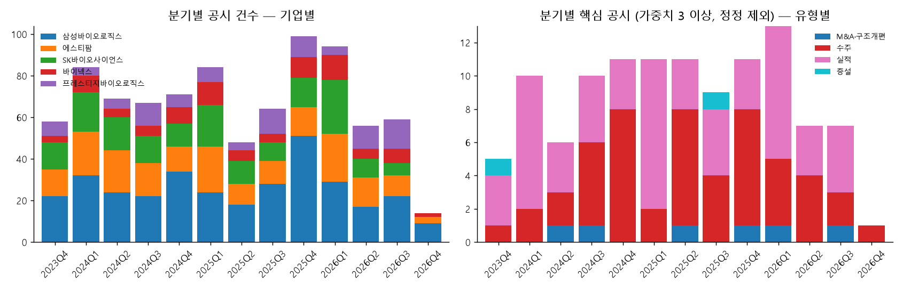

# Day 3 — 텍스트 정제와 EDA

> **상태:** 작성 완료 · **최종 갱신:** 2026-11-16
> **산출 기준:** `data/db/bio_cdmo.sqlite` 2026-11-16 빌드 (뉴스 9,216건 · 공시 867건), `analysis/eda.py`
> **관련 문서:** [news_sort](news_sort.md) · [data_schema](data_schema.md) · [PRD F1](02_product-requirements/PRD.md) · [ACCEPTANCE_CRITERIA AC-03](02_product-requirements/ACCEPTANCE_CRITERIA.md)
> **재현:** `python db/build_db.py` → `python analysis/eda.py` (정제 점검은 `python analysis/clean_text.py`)

과제 가이드 Day 3의 완료 기준은 "이슈 급증 시점을 근거와 함께 제시할 수 있다"이다. 이 문서는 ① 텍스트 정제 규칙과 결과, ② 기사량·공시 건수 추이, ③ 급증 시점과 그 근거(기사·공시 링크)를 정리한다.

---

## 1. 요약

- **기사량 추이는 수집출처를 나눠 봐야 한다.** 2026년 기사가 3,932건으로 2025년(2,684건)보다 46% 많지만, 팀원수집 1,162건이 2026년에 몰린 영향이 크다. 팀원수집을 빼면 2,620건 → 2,770건(+6%)이다. 이후 추이·급증 분석은 **팀원수집 제외**를 기준으로 했다.
- **분석에 쓸 수 있는 CDMO 기사는 4,151건(45%)이다.** 중복 제외 9,142건 중 3,687건(40%)은 CDMO와 무관하고, 576건은 검색어만 근거라 제외를 권장한다.
- **산업 전체 급증 시점은 6번**이고, 가장 큰 두 번은 모두 삼성바이오로직스의 구조 변화이다: **2026-07-20 폴리펩타이드 인수 발표**(주 108건, 평소 30.5건), **2025-05-22 인적분할 발표**(주 52건, 평소 17.5건).
- **기업별 급증 34건 중 24건(71%)은 같은 시기에 가중치 있는 공시가 있었다.** 이 중 기사 제목과 공시를 대조해 같은 사건으로 확인한 사례는 11건이다(4-3절). 수주·증설·M&A·실적은 공시와 기사가 같은 날 나온 사례가 많아(바이넥스 2025-09-22 증설, 에스티팜 2026-09-18 수주 등) 뉴스–공시 연결(F4)의 근거가 된다.
- **기사 급증이 곧 사업 이슈는 아니다.** 인재 양성 협약, 사내 앱 수상, 신사옥 행사 같은 홍보성 보도도 급증으로 잡힌다. 급증 시점은 후보이고, 이슈 유형 판단은 Day 4(LLM 이슈 추출)에서 한다.

---

## 2. 텍스트 정제

원문(`news.title`, `news.body`)은 그대로 두고, 정제한 텍스트를 `news_clean` 테이블(`title_clean`, `body_clean`, `body_clean_len`)에 따로 싣는다. 규칙은 `analysis/clean_text.py` 에 있고 `db/build_db.py` 가 적재할 때 부른다. LLM 입력·임베딩·화면 표시에는 `news_clean` 을 쓴다.

**원칙:** 기사 내용이 아닌 것만 지운다. 의미가 바뀔 수 있는 것(말머리 `[단독]`, 말줄임표, 한자, `<앵커>` 같은 방송 표기)은 남긴다.

| 대상 | 규칙 | 예 |
|---|---|---|
| 공통 | BOM·폭 없는 공백 제거, HTML 엔티티 복원, HTML 태그 제거, 둥근 따옴표를 곧은 따옴표로 통일, 연속 공백 정리 | `“AI로 신약 개발”` → `"AI로 신약 개발"` |
| 본문 첫머리 | 발신지·기자 표기 제거 | `[팜뉴스=○○○ 기자]`, `(서울 뉴스1)`, `【 청년일보 】` |
| 본문 줄 단위 (팀원수집) | 저작권·제보·구독 안내, 댓글 영역 문구, `▶기사 바로가기` 와 그 다음 줄, 기자 서명 줄 제거 | `저작권자 © … 무단 전재 및 재배포 금지`, `○○○ 기자 abc@press.co.kr` |
| 본문 끝 (제공 뉴스, 한 줄 본문) | 끝에 붙은 저작권·제보 문구 제거 | `Copyright … All rights reserved.`, `…여러분의 제보를 기다립니다. 카카오톡 …` |
| 본문 전체 | 이메일, URL, 사진·자료 출처 괄호 제거 | `(사진=○○○)`, `[제공=○○○]` |

### 정제 결과 (`python analysis/clean_text.py`)

| 수집출처 | 기사 | 제목이 바뀐 기사 | 본문 있는 기사 | 본문이 바뀐 기사 | 본문 글자 수 (전 → 후) | 감소 |
|---|---|---|---|---|---|---|
| 제공 | 2,792 | 611 | 2,790 | 1,420 | 4,404,765 → 4,379,675 | 0.6% |
| 팀원수집 | 1,306 | 172 | 1,269 | 1,269 | 3,469,533 → 3,422,874 | 1.3% |
| 기업명검색 | 2,202 | 461 | 0 | – | – | – |
| CDMO검색 | 2,119 | 459 | 0 | – | – | – |
| 해외검색 | 797 | 76 | 0 | – | – | – |

- 제목이 바뀐 1,779건은 거의 모두 따옴표 통일이다.
- 팀원수집 본문이 모두 바뀐 것은 줄바꿈(`\r\n` → `\n`) 통일 때문이다. 내용이 지워진 것은 기자 표기·저작권 문구 등 일부다.
- 이메일이 있던 본문 199건, URL 34건, 저작권 문구 125건(제공 16 · 팀원수집 109)이 정제 후 모두 0건이다.
- 정제 후 본문이 비게 된 기사는 없다(최소 62자).

### 정제의 한계

- **제공 뉴스는 받은 시점에 이미 문장부호 일부가 빠져 있다** (`R&D` → `R D`, 줄바꿈 없음). 복원할 수 없어 그대로 두었다.
- **사진 설명 문장은 지우지 못한다.** "○○○ 대표(왼쪽)가 … 기념촬영을 하고 있다" 같은 문장은 본문과 구분할 규칙이 없다.
- **맨 끝 표본 120자 기준으로 27건에 꼬리 문구가 남아 있다** (`/매체명 ○○○ 기자`, `○○○ 바이오 전문기자` 등 형식이 제각각인 서명). 감성·이슈 판단에 영향이 작아 규칙을 더 넓히지 않았다.
- **중복 판정(`title_norm`, `dup_of`)은 바꾸지 않았다.** 원래도 한글·영문·숫자만 남겨 비교하므로 따옴표 통일의 영향이 없다. 중복 74건은 그대로다.

---

## 3. 기사량 추이

### 3-1. 수집출처별 월별 기사량

| 연도 | 제공 | 팀원수집 | 기업명검색 | CDMO검색 | 해외검색 | 전체 | 팀원수집 제외 |
|---|---|---|---|---|---|---|---|
| 2023 (10-19~) | 123 | 9 | 121 | 63 | 32 | 348 | 339 |
| 2024 | 834 | 71 | 573 | 463 | 237 | 2,178 | 2,107 |
| 2025 | 975 | 64 | 704 | 663 | 278 | 2,684 | 2,620 |
| 2026 (~10-19) | 786 | 1,162 | 804 | 930 | 250 | 3,932 | 2,770 |

중복(`dup_of`) 제외 9,142건 기준. 월별 값은 `data/processed/eda_news_monthly.csv`.

- **2026-04 이후의 급증은 대부분 수집 방식 때문이다.** 팀원수집이 2026-06에 264건, 2026-09에 229건으로, 그 전 30개월 합계(175건)보다 많다. 검색어마다 최신순으로 받은 자료라 최근에 몰린다.
- **팀원수집을 빼도 완만한 증가는 남는다.** 월평균이 2024년 176건 → 2025년 218건 → 2026년 약 280건이다. 다만 CDMO검색(2024년 463 → 2026년 930)도 구글 뉴스가 최근 기사를 더 많이 돌려주는 영향을 받으므로, "관심이 늘었다"고 단정하지 않고 **직전 26주 대비 급증**만 본다(4절).
- 제공 뉴스는 월 33~117건으로 가장 고르다. 2024-11(117건), 2026-07(116건), 2026-09(115건)가 높다.

### 3-2. 분석 범위 — CDMO와 무관한 기사 비중

가이드 2-3은 "키워드별 기사량과 무관한 기사의 비중을 확인하고 분석에 활용할 범위를 판단"하도록 한다.

| 수집출처 | 제목·본문 근거 | 키워드만 검색어 근거 | CDMO 관련·6개 이슈 밖 | 검색어만 근거 (제외 권장) | CDMO 무관 | 전체 |
|---|---|---|---|---|---|---|
| 제공 | 247 | 0 | 70 | 0 | 2,401 | 2,718 |
| 팀원수집 | 977 | 5 | 60 | 0 | 264 | 1,306 |
| 기업명검색 | 582 | 0 | 598 | 0 | 1,022 | 2,202 |
| CDMO검색 | 1,238 | 384 | 0 | 497 | 0 | 2,119 |
| 해외검색 | 638 | 80 | 0 | 79 | 0 | 797 |
| **전체** | **3,682** | **469** | **728** | **576** | **3,687** | **9,142** |

`data/processed/eda_news_scope.csv`. 구분 기준은 `cdmo_rel_basis` · `cdmo_kw_basis` ([news_sort](news_sort.md) 3절).

- **제공 뉴스의 88%(2,401건)는 CDMO와 무관하다.** 바이오 전반 키워드(R&D·규제·특허 등)로 수집된 자료이기 때문이다. 산업 이슈 분석에는 247건만 직접 쓰인다.
- **기업명검색의 46%(1,022건)도 CDMO 무관**으로 분류된다. 기업 동향(인사·주가·사회공헌)이 많다. 기업 단위 분석에는 쓰되 산업 이슈 집계에서는 빠진다.
- **권장 분석 범위:** 이슈 분석은 "제목·본문 근거" + "키워드만 검색어 근거" = **4,151건**. 검색어만 근거인 576건은 제외한다. 급증 판정(4절)의 산업 전체 계열은 여기에 "CDMO 관련·6개 이슈 밖"을 더하고 팀원수집을 뺀 것이다.

### 3-3. CDMO 키워드별 월별 기사량

대표 키워드 기준, 검색어 근거·중복 제외. 막대는 전체, 선은 팀원수집 제외. `data/processed/eda_keyword_monthly.csv`.

- **규제·정책은 팀원수집 의존도가 가장 높다.** 2026년 2~3분기 막대가 크게 솟지만 선(팀원수집 제외)은 평탄하다. 팀원 검색어가 `CDMO 규제` 였기 때문이며, 이 구간의 규제 기사 증가는 이슈 급증으로 해석하지 않는다.
- **모달리티·경쟁 구도·수주는 선도 2026-07에 솟는다.** 폴리펩타이드 인수(펩타이드 CDMO 진출)가 세 키워드에 걸쳐 잡힌 것이다(4-1절).
- **지정학은 2024-09(생물보안법 하원 통과), 2026-04(미국 의약품 관세)** 에 봉우리가 있다.

### 3-4. 기업별 기사량과 공시 건수

기업명이 제목·본문에 있는 기사(`match_field` 가 `title`·`body`), 중복·팀원수집 제외. `data/processed/eda_company_monthly.csv`.

| 기업 | 뉴스 2024 | 뉴스 2025 | 뉴스 2026 | 공시 2024 | 공시 2025 | 공시 2026 |
|---|---|---|---|---|---|---|
| 삼성바이오로직스 | 279 | 398 | 582 | 112 | 121 | 77 |
| 에스티팜 | 47 | 69 | 195 | 69 | 57 | 50 |
| SK바이오사이언스 | 107 | 107 | 239 | 59 | 54 | 41 |
| 바이넥스 | 10 | 40 | 22 | 25 | 30 | 26 |
| 프레스티지바이오로직스 | 14 | 15 | 27 | 26 | 33 | 29 |

- **기사량은 삼성바이오로직스에 쏠려 있다.** 5개사 기사의 약 59%이다. 바이넥스·프레스티지바이오로직스는 월 0~5건 수준이라 월별 추이보다 개별 사건 단위로 봐야 한다.
- **공시 건수와 기사량은 월 단위로는 같이 움직이지 않는다.** 공시가 가장 많은 달(삼성바이오로직스 2025-11, 31건)은 인적분할 뒤의 지분 변동 신고가 몰린 것으로, 기사량은 평소 수준이다. 공시 건수가 아니라 **공시 유형**으로 맞춰 봐야 한다(5절).

---

## 4. 이슈 급증 시점

### 판정 방법

- **단위:** 주(월요일 시작). 기간 양 끝의 덜 찬 주는 뺀다.
- **기준:** 직전 26주의 중앙값. 수집출처 편중과 완만한 증가 추세의 영향을 줄이기 위해 전체 평균이 아니라 직전 구간과 비교한다.
- **급증:** `z = (그 주 건수 − 중앙값) / 산포 ≥ 3` 이고 최소 건수(산업 전체 20건, 키워드 8건, 기업 6건) 이상. 산포는 MAD × 1.4826 이며 `sqrt(중앙값)` 과 1 중 큰 값을 하한으로 둔다.
- **사건 묶기:** 급증 주가 이어지면 한 사건으로 본다.
- **대상:** 중복 제외, 팀원수집 제외. 산업 전체는 CDMO 관련 기사(검색어만 근거 제외), 키워드는 대표 키워드(검색어 근거 제외), 기업은 기업명이 제목·본문에 있는 기사.
- **근거:** 사건마다 정점 일, 대표 기사 3건(매체 중복 없이)과 링크, 제목 빈출어, 같은 시기(사건 1주 전 ~ 2주 뒤)의 가중치 있는 공시를 `data/processed/eda_spikes.csv` 에 남긴다.

결과는 **67건**이다 (산업 전체 6 · 키워드 27 · 기업 34).

### 4-1. 산업 전체 (6건)

| 급증 주 | 건수 (평소) | z | 정점 일 | 배경 | 근거 |
|---|---|---|---|---|---|
| 2026-07-20 | 108 (30.5) | 8.0 | 07-20 (52건) | **삼성바이오로직스, 폴리펩타이드 2.7조 원 인수 발표** — 펩타이드(비만약) CDMO 진출, 국내 제약·바이오 최대 M&A | [조선비즈](https://n.news.naver.com/article/366/0001180236) · 제목 빈출어: 인수 34, 폴리펩타이드 27, 펩타이드 24, 비만약 23 |
| 2025-05-19 | 52 (17.5) | 5.2 | 05-22 (30건) | **삼성바이오로직스 인적분할 발표** — CDMO와 바이오시밀러(삼성에피스홀딩스) 분리 | [이데일리](https://n.news.naver.com/mnews/article/018/0006020629) · 공시 2025-05-22 주요사항보고서(회사분할결정) |
| 2025-06-16 | 48 (17.0) | 4.2 | 06-18 (14건) | **바이오 USA 2025** — 삼성바이오로직스 오가노이드 CRO 진출, 각 사 수주·계약 발표 | 제목 빈출어: USA 12, 계약 8, 수주 8, 오가노이드 6 |
| 2026-10-05 | 80 (37.5) | 3.6 | 10-06 (30건) | **CPHI 밀라노 참가와 수주 홍보**, 삼성바이오로직스 3분기 실적 전망·노사 이슈가 겹침 | 제목 빈출어: 수주 19, CPHI 15, 에스티팜 14, 유한양행 11 |
| 2026-06-22 | 60 (31.0) | 3.3 | 06-24 (19건) | **바이오 USA 2026** — 에스티팜 RNA CDMO, 삼성바이오로직스 유럽 영업거점·3캠퍼스 착공 | 제목 빈출어: USA 21, 에스티팜 9, 공장 7 |
| 2025-10-27 | 40 (21.5) | 3.1 | 10-30 (11건) | **CPHI 2025**와 3분기 실적 시즌. 한 사건으로 묶이지 않는 약한 급증 | 제목 빈출어: CPHI 6, 매출 4, 공장 4 |

- 6건 중 2건은 **단일 기업의 구조 변화**(M&A, 분할), 4건은 **정기 행사**(바이오 USA 6월, CPHI 10월)이다. 행사 주간의 급증은 매년 반복되므로, 대시보드에서 "이슈 급증"으로 표시할 때 행사 주간임을 함께 적어야 오해가 없다.
- 2026-10-12 주도 61건으로 높지만(전 주 80건에 이어) 판정 기준에는 못 미쳤다.

### 4-2. 키워드별 주요 급증 (27건 중 z ≥ 5 위주)

| 키워드 | 급증 주 | 건수 (평소) | z | 배경 | 근거 기사 |
|---|---|---|---|---|---|
| 모달리티 | 2026-07-20 | 50 (4.0) | 15.5 | 폴리펩타이드 인수 → 펩타이드 CDMO 진출 | 삼성바이오로직스, 2.7조원에 폴리펩타이드 인수 (조선비즈) |
| 경쟁 구도 | 2026-07-20 | 23 (3.0) | 11.5 | 같은 사건 (M&A 관점) | 삼성바이오, 2.7조 '빅딜'로 펩타이드 진출 (머니투데이) |
| 경쟁 구도 | 2025-05-19 | 27 (2.5) | 11.0 | 삼성바이오로직스 인적분할 | 삼성바이오 인적분할…삼성에피스홀딩스 설립 (서울경제) |
| 모달리티 | 2026-10-12 | 28 (5.0) | 7.8 | 폴리펩타이드 공개매수 약 88% 확보 | 폴리펩타이드 공개매수 87.88% 확보 (파이낸셜뉴스) |
| 지정학 | 2026-03-30 ~ 04-12 | 13 (2.0) | 7.4 | **미국 의약품 관세 도입** (최대 100%, 한국 15%) | 미국 100% 의약품 관세…한국 15% 불구 영향 불가피 (데일리메디) |
| 수주 | 2026-10-05 | 23 (6.0) | 6.9 | CPHI 밀라노, 수주 확대 홍보 | 유한양행, CPHI 밀란 참가…CDMO 수주 확대 추진 (뉴스핌) |
| 경쟁 구도 | 2024-02-05 | 11 (1.0) | 6.7 | **노보 홀딩스의 카탈런트 인수** (165억 달러) | 노보 홀딩스, 세계 2위 CDMO 카탈런트 인수 (MEDI:GATE NEWS) |
| 규제·정책 | 2025-01-20 | 11 (1.0) | 6.7 | **국가바이오위원회 출범** — 위탁생산 역량 2.5배 확대 목표 | [노컷뉴스](https://n.news.naver.com/mnews/article/079/0003985386) |
| 모달리티 | 2026-08-24 | 24 (4.0) | 6.7 | 삼성바이오로직스 3조 원 유상증자 (인수·증설 자금) | 삼성바이오, 3조원 주주배정 유증 (한국경제) |
| 생산능력 | 2026-03-30 | 14 (3.0) | 6.4 | 삼성바이오로직스, GSK 미국 록빌 공장 인수 완료 | 삼성바이오로직스, 美 록빌 공장 인수 마무리 (딜사이트) |
| 경쟁 구도 | 2024-12-16 | 9 (1.0) | 5.4 | **셀트리온바이오솔루션스 출범** — 셀트리온의 CDMO 진출 | 셀트리온 CDMO, '셀트리온바이오솔루션스' 출범 (바이오스펙테이터) |
| 지정학 | 2024-09-09 | 8 (1.0) | 4.7 | **미국 생물보안법 하원 통과** | 중국 기업 옥죄는 '바이오보안법'...미국 하원 통과 (이코노미스트) |
| 지정학 | 2026-06-08 | 10 (3.0) | 4.0 | 미 국방부, 우시앱텍·BGI '중국군사기업' 지정 | 美 국방부, 우시앱택·BGI '중국군사기업' 지정 (더바이오) |
| 생산능력 | 2025-09-22 | 14 (3.0) | 3.7 | 바이넥스 오송공장 557억 원 증설 | 바이넥스, 557억 규모 오송공장 증설 (뉴스1) |

전체 27건과 기사 링크는 `data/processed/eda_spikes.csv` (`series = 키워드`).

- **규제·정책 급증은 1건뿐이다** (국가바이오위원회 출범). 팀원수집을 뺀 규제 기사가 주 1~3건 수준이라 급증으로 잡히기 어렵다. CDMO 특별법 등 규제 흐름은 급증보다 누적 추이로 봐야 한다.
- **지정학 3건은 모두 미국 정책**(생물보안법, 의약품 관세, 중국군사기업 지정)이고, 해외검색(영어) 기사가 함께 잡혔다.
- 키워드 규칙의 한계가 급증에도 나타난다. 예를 들어 수주 2026-01-19 급증은 삼성바이오로직스·셀트리온의 연간 실적 기사로, `실적`·`매출` 표현 때문에 수주로 묶인 것이다([news_sort](news_sort.md) 5절의 알려진 오분류).

### 4-3. 기업별 급증과 공시 (34건)

주황 눈금은 핵심 공시(가중치 3 이상, 정정 제외) 접수일이다.

| 기업 | 급증 | 같은 시기 공시 있음 |
|---|---|---|
| 삼성바이오로직스 | 12 | 10 |
| SK바이오사이언스 | 14 | 8 |
| 에스티팜 | 7 | 5 |
| 바이넥스 | 1 | 1 |
| 프레스티지바이오로직스 | 0 | – |
| **합계** | **34** | **24 (71%)** |

"같은 시기 공시 있음"은 급증 1주 전 ~ 2주 뒤에 가중치 있는 공시가 접수됐다는 뜻이다. 같은 사건이라는 뜻은 아니다. 예를 들어 삼성바이오로직스 2025-12-22 급증의 기사는 GSK 미국 록빌 공장 인수인데, 같은 날 공시 3건은 모두 수주(단일판매ㆍ공급계약체결)이다. 아래 표는 기사 제목과 공시명·원문을 대조해 같은 사건으로 확인한 것만 실었다.

**기사 급증과 공시가 같은 사건으로 확인되는 사례**

| 기업 | 급증 주 | 건수 (평소) | 기사 | 공시 |
|---|---|---|---|---|
| 삼성바이오로직스 | 2026-07-20 | 85 (8.5) | 폴리펩타이드 2.7조 원 인수 | [2026-08-31 타법인주식및출자증권취득결정](https://dart.fss.or.kr/dsaf001/main.do?rcpNo=20260831800556) — PolyPeptide Group AG, 취득금액 2조 7,062억 원. 발표 6주 뒤이며, 발표 주에는 2026-07-23 잠정실적 공시만 있다 |
| 삼성바이오로직스 | 2026-08-24 | 44 (9.0) | 3조 원 주주배정 유상증자 | 2026-08-28 주요사항보고서(유상증자결정) |
| 삼성바이오로직스 | 2025-05-19 | 38 (4.0) | 인적분할, 삼성에피스홀딩스 설립 | 2025-05-22 주요사항보고서(회사분할결정) |
| 삼성바이오로직스 | 2024-01-22 | 14 (3.0) | 연간 영업이익 1조 원 돌파 | 2024-01-24 영업(잠정)실적 공정공시 |
| SK바이오사이언스 | 2024-06-24 | 12 (1.0) | 독일 IDT 바이오로지카 인수 | [2024-06-27 타법인주식및출자증권취득결정](https://dart.fss.or.kr/dsaf001/main.do?rcpNo=20240627800002), 유상증자결정 |
| SK바이오사이언스 | 2026-02-02 | 9 (2.0) | 2025년 매출 6,514억 원 (+144%) | 2026-02-03 잠정실적, 손익구조 변경 |
| SK바이오사이언스 | 2026-08-10 | 17 (3.5) | 2분기 매출 1,557억 원·영업손실 157억 원 | 2026-08-10 잠정실적 |
| 에스티팜 | 2026-09-14 | 20 (2.5) | 913억 원 올리고 핵산 원료 수주 (단일계약 최대) | [2026-09-18 단일판매ㆍ공급계약체결](https://dart.fss.or.kr/dsaf001/main.do?rcpNo=20260918900224) |
| 에스티팜 | 2026-01-19 | 7 (1.0) | 825억 원 올리고 핵산 원료 공급계약 | 2026-01-23 단일판매ㆍ공급계약체결 |
| 에스티팜 | 2026-04-27 | 11 (2.0) | 1분기 영업이익 115억 원 | 2026-04-27 잠정실적 |
| 바이넥스 | 2025-09-22 | 14 (0.0) | 오송공장 557억 원 증설 | [2025-09-22 신규시설투자등](https://dart.fss.or.kr/dsaf001/main.do?rcpNo=20250922900023) |

**공시 없이 기사만 급증한 사례 (10건)** — 대부분 공시 의무가 없는 사건이다.

| 유형 | 사례 |
|---|---|
| 행사·발표 | 삼성바이오로직스 2024-06-03 바이오 USA·한미일인도EU 바이오제약 연합 출범, 에스티팜 2026-06-22 바이오 USA |
| 시설 준공 | 에스티팜 2025-09-01 제2올리고동 준공 |
| 인사·조직 | SK바이오사이언스 2026-01-19 COO 신설(z 16.9, 5개사 중 최고), 2025-12-15 원액생산실장 영입, 2026-04-06 R&D 부사장 영입 |
| 투자·특허 | SK바이오사이언스 2024-10-07 미국 백신 R&D 기업 지분 인수, 2025-04-21 모더나 mRNA 특허 무효화 |
| 홍보성 | 삼성바이오로직스 2025-02-17 고려대·성균관대 인재 양성 협약, SK바이오사이언스 2026-05-25 송도 신사옥 행사 |

- **수주·증설·M&A·실적은 공시와 기사가 같은 날 또는 며칠 안에 나온다.** 뉴스–공시 매칭(F4)은 "기업 + 접수일 ±3일 + 유형"으로 시작할 수 있다. 다만 폴리펩타이드 인수처럼 발표와 취득결정 공시가 6주 떨어진 경우도 있다.
- **홍보성 급증을 걸러야 한다.** SK바이오사이언스는 급증 14건 중 6건이 공시가 없고, 인사·행사 보도가 많다. 공시가 있는 급증에도 사내 앱 디자인상(2024-03-04), 연세대 인재 양성 협약(삼성바이오로직스 2024-08-26)처럼 공시와 무관한 홍보성 보도가 있다. 기사량만으로 이슈 순위를 매기면 이런 보도가 위로 올라온다.
- **프레스티지바이오로직스는 급증이 없다.** 주 최대 4건이라 최소 건수(6건)에 닿지 않는다. 이 기업은 기사가 아니라 공시(수주 21건)로 봐야 한다.
- **삼성바이오로직스는 하루 100건 수집 상한의 영향을 받을 수 있다** ([data_schema](data_schema.md) 5절). 2026-07-20(50건) 같은 날은 실제 기사량이 더 많았을 수 있다.

---

## 5. 공시 추이

| 분기 | 삼성바이오로직스 | 에스티팜 | SK바이오사이언스 | 바이넥스 | 프레스티지바이오로직스 | 전체 |
|---|---|---|---|---|---|---|
| 2023Q4 (10-19~) | 22 | 13 | 13 | 3 | 7 | 58 |
| 2024Q1 | 32 | 21 | 19 | 8 | 4 | 84 |
| 2024Q2 | 24 | 20 | 16 | 4 | 5 | 69 |
| 2024Q3 | 22 | 16 | 13 | 5 | 11 | 67 |
| 2024Q4 | 34 | 12 | 11 | 8 | 6 | 71 |
| 2025Q1 | 24 | 22 | 20 | 11 | 7 | 84 |
| 2025Q2 | 18 | 10 | 11 | 5 | 4 | 48 |
| 2025Q3 | 28 | 11 | 9 | 4 | 12 | 64 |
| 2025Q4 | 51 | 14 | 14 | 10 | 10 | 99 |
| 2026Q1 | 29 | 23 | 26 | 12 | 4 | 94 |
| 2026Q2 | 17 | 14 | 9 | 5 | 11 | 56 |
| 2026Q3 | 22 | 10 | 6 | 7 | 14 | 59 |
| 2026Q4 (~10-19) | 9 | 3 | 0 | 2 | 0 | 14 |

`data/processed/eda_disclosure_quarterly.csv`, 유형별은 `eda_disclosure_class.csv`.

- **1분기에 몰리는 계절성이 있다.** 2월 102건, 3월 118건으로 다른 달(42~85건)보다 많다. 결산 실적, 주주총회, 사업보고서 때문이다. 공시 건수 증가를 이슈로 해석하지 않는다.
- **2025Q4의 99건은 삼성바이오로직스(51건) 때문이다.** 인적분할 뒤 임시주주총회·지분 변동 신고(기타 34건)와 수주 공시 14건이 겹쳤다.
- **공시의 54%(469건)는 지분·주총·행정 공시(가중치 0)이다.** 사업 이슈로 볼 수 있는 것은 수주 98건, 실적 57건, 임상·허가·기술계약 54건, M&A·구조개편 15건, 자금조달 12건, 증설 5건이다.
- **수주 공시의 절반(98건 중 49건)은 정정 공시다.** 계약 금액·기간 변경이 많다. 건수를 셀 때는 정정을 빼고(`is_amended = 0`), 금액 추이는 최신 정정본 기준으로 봐야 한다.
- **기업별 특징:** 수주 공시는 삼성바이오로직스 53건·프레스티지바이오로직스 21건·에스티팜 12건, IR은 에스티팜 46건·SK바이오사이언스 24건, 임상·허가·기술계약은 삼성바이오로직스 25건·SK바이오사이언스 22건에 몰려 있다.

---

## 6. 다음 단계에 넘기는 것

| 대상 | 내용 |
|---|---|
| Day 4 LLM 이슈 추출 | 입력은 `news_clean` 을 쓴다. 급증 67건(`eda_spikes.csv`)에 이슈 유형(사업/행사/홍보)을 붙이면 홍보성 급증을 걸러낼 수 있다 |
| Day 4 감성 분류 | 처리 범위를 3-2절 권장 범위(4,151건)와 맞출지 확인이 필요하다. 감성 분류 문서(`04_ai/AI_CLASSIFICATION.md`, 다른 브랜치에서 작성 중)는 4,727건을 범위로 잡고 있다 |
| Day 5 공시 Q&A | 기업 급증 중 공시가 확인된 사례(4-3절 표)를 Q&A 평가 질문으로 쓸 수 있다 (예: "에스티팜의 2026년 9월 수주 계약 규모는?") |
| Day 6 대시보드 (F1) | 월별 기사량 차트는 수집출처 필터 또는 "팀원수집 제외" 기본값이 필요하다. 급증 표시에는 행사 주간(바이오 USA, CPHI) 주석을 붙인다. 집계 CSV를 그대로 읽을 수 있다 |

## 7. 한계

- **급증 판정은 기사량 기준이다.** 기사 내용의 중요도가 아니라 보도 건수를 본다. 같은 보도자료를 여러 매체가 실으면 급증이 된다(제목이 다르면 중복으로 잡히지 않는다).
- **기준값(z ≥ 3, 26주, 최소 건수)은 표본을 보고 정한 값이다.** 민감도를 따로 검증하지 않았다. 값은 `analysis/eda.py` 상단 상수로 바꿀 수 있다.
- **분석 초기 구간은 판정하지 않는다.** 기준 구간이 12주 쌓이기 전(2024-01 중순 이전)의 급증은 잡지 못한다.
- **팀원수집 1,306건을 급증 판정에서 뺐다.** 본문이 있는 자료라 이슈 내용 분석에는 쓰지만, 시기 편중 때문에 추이에는 쓰지 않았다.
- **배경 설명은 기사 제목과 공시명을 읽고 붙인 것이다.** 본문 전체를 검토한 것은 아니며, 대표 기사는 정점 일의 기사 중 규칙으로 고른 3건이다.
- **CDMO 키워드 분류 정확도는 여전히 미검수이다.** 키워드별 급증은 규칙 기반 분류의 오류를 그대로 안고 있다.
